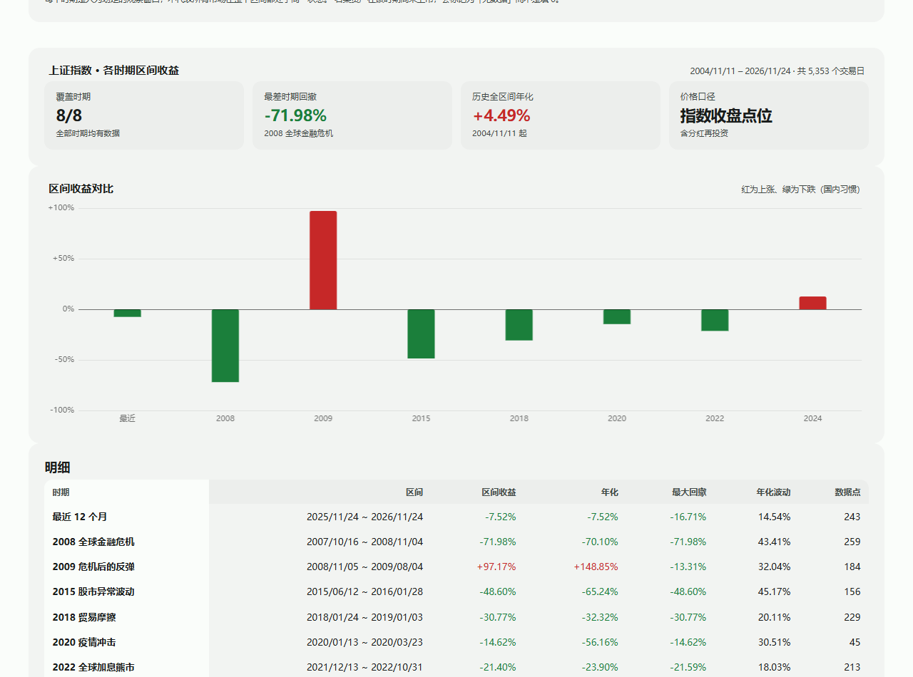
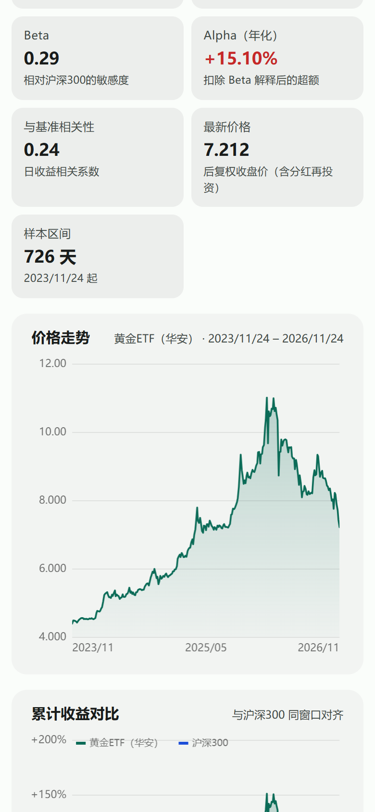

# 投资实验室 · Investment Lab

> 用二十年真实行情，把投资里那些「听起来懂了」的概念，变成你亲手算过一遍的数字。

在线站点：**https://angelky7.github.io/investment-lab/**

这是一个完全开源、零构建、零广告的投资学习实验室。它不荐股、不给目标价、不做预测，
只做三件事：**把收益讲清楚、把风险摆出来、把历史摊开看**。

- 界面基于 [MDUI 2](https://www.mdui.org)（Material You / Web Components），明暗双主题、移动端适配；
- 计算全部在浏览器里完成，公式开源，任何一个数字都能用 Excel 或 Python 复算；
- 数据每天由 GitHub Actions 自动更新并部署。


<sub>首页：四项资产的最新真实数字，以及七个入口。</sub>

| 资产分析（深色主题） | 历史时期复盘 |
|---|---|
|  |  |

| 组合压力测试 | 数据完整性（缺口逐条公开） |
|---|---|
|  |  |


<sub>配置求解器：每个点是一组合格配比，红线左侧在回撤预算内、蓝线上方达到收益目标。左上角的空白才是重点。</sub>


<sub>策略组合回测：四档配置、阈值带再平衡，并与「100% 股票」同区间对照。</sub>

<p>
  
  
</p>

<sub>竖屏（390×844）：指标卡两列、图表自适应、表单控件独占一行；
美股个股的 Beta 与相关性按标普500 计算；已适配 320–430px 宽度与横屏手机。</sub>

---

## 目录

- [一张图看清结构](#一张图看清结构)
- [八大页面](#八大页面)
- [资产覆盖](#资产覆盖)
- [数据管线](#数据管线)
- [配置求解器：按约束算，而不是按等级给](#配置求解器按约束算而不是按等级给)
- [策略组合：哈利·布朗永久组合](#策略组合哈利布朗永久组合)
- [指标定义与口径](#指标定义与口径)
- [为什么用后复权](#为什么用后复权)
- [本地开发](#本地开发)
- [测试](#测试)
- [自动化与部署](#自动化与部署)
- [已知局限](#已知局限)
- [免责声明](#免责声明)
- [许可](#许可)

---

## 一张图看清结构

```
investment-lab/
├── index.html              首页：数据速览 + 七个入口
├── learn.html              46 节深课（小白/进阶/高级/策略）+ 每节自测 + 5 个互动实验室
├── glossary.html           术语词典：定义 + 本站实例 + 常见误解，支持关键词过滤
├── corrections.html        更正记录：说错过的六处，含原话、证据、为什么会错、对用户的影响
├── analysis.html           资产分析：单资产全指标 + 多资产同窗口对比
├── portfolio.html          组合分析：相关性 / 定投 / 压力测试 / 再平衡
├── history.html            历史时期复盘：7 个真实市场窗口 + 最近 12 个月
├── calculator.html         计算器：复利 / 定投 / 回撤回本 / 再平衡
├── planner.html            配置求解器：四题问卷 → 候选配比回测筛选（不构成推荐）
├── data.html               数据状态：来源、新鲜度、逐项完整性
│
├── css/app.css             业务样式（全部基于 MDUI 设计令牌，无硬编码浅色值）
├── vendor/mdui/            MDUI 2.1.5（MIT，随仓库分发，不依赖 CDN）
│
├── js/core/                纯逻辑层（可在 Node 里单测）
│   ├── series.js           序列工具：收益、回撤、日期对齐、降采样、直方图
│   ├── stats.js            指标引擎：年化、波动、夏普、索提诺、卡玛、Beta/Alpha
│   ├── portfolio.js        组合引擎：相关性、定投（含 XIRR）、再平衡、阈值带、压力测试
│   ├── strategies.js       预设策略（永久组合 / 60-40 / 对照）
│   ├── planner.js          配置求解：答案→约束、候选枚举、筛选与解释
│   ├── calc.js             计算器数学
│   ├── format.js           数字/日期格式化（红涨绿跌）
│   ├── store.js            数据加载与缓存
│   ├── charts.js           Canvas 图表（含十字线、主题跟随、HiDPI）
│   ├── shell.js            全站外壳：导航抽屉、主题切换、页脚
│   └── icons.js            内联 SVG 图标（不加载图标字体）
├── js/ui/                  通用控件：资产选择器、指标卡、表格
├── js/pages/               每个页面的入口模块
│
├── config/                 权威配置（提交到仓库）
│   ├── assets.json         55 项资产的登记表（名称、分组、代码、起始年份）
│   └── periods.json        历史时期与压力情景定义
├── data/                   构建产物（由脚本生成，勿手改）
│   ├── assets.json         资产索引（前端首屏只加载这个）
│   ├── meta.json           数据版本、截止日期、统计
│   ├── periods.json        时期与情景
│   ├── quality.json        质量校验报告
│   └── history/            {type}_{symbol}.json，列式存储
├── data_sources/           数据源实现（腾讯 / 东方财富）
├── scripts/                fetch / build / validate / repair / check_links / summary
├── tests/                  Node 单元测试 + Python 管线测试
│   └── e2e/                无头浏览器端到端（逐页切换子页签）
└── .github/workflows/      ci / update-data / deploy
```

---

## 八大页面

| 页面 | 解决什么问题 | 你会动手做什么 |
|------|--------------|----------------|
| 首页 | 这套工具可信吗 | 看四项资产的最新真实数字 |
| 投资课程 | 概念到底在说什么 | 四个可动手的实验室：复利 / 分散 / 配比 / 2008 体验馆 |
| 资产分析 | 这项资产好不好 | 对比两个资产的波动与回撤，看 Beta/Alpha |
| 组合分析 | 分散为什么有效 | 亲手算相关性、跑定投与压力测试、回测永久组合、看再平衡的权重漂移 |
| 历史时期 | 极端时刻会发生什么 | 把资产放进 2008 / 2015 / 2020 等真实窗口 |
| 计算器 | 复利与再平衡怎么运作 | 改参数看曲线如何变化 |
| **配置求解器** | 我的约束下还剩什么配比 | 答四题，看 100+ 组候选配置的回测筛选 |
| 数据状态 | 数据本身可靠吗 | 检查覆盖范围与断档 |

---

## 资产覆盖

**84 项资产、35.2 万条日频记录**（含 1 条月度 CPI），覆盖 A 股 / 港股 / 美股三个市场、股票 / ETF / 指数 / 场外基金四种类型。

表内为全部 14 个指数（含本次新增的恒生指数与中证A500）：

| 指数 | 代码 | 起点 | 记录数 | 备注 |
|------|------|------|--------|------|
| 沪深300 | 000300 | 2005-01 | 5316 | 全站默认基准 |
| 中证500 | 000905 | 2006-11 | 4865 | |
| 中证1000 | 000852 | 2013-11 | 3165 | |
| **中证A500** | 000510 | **2024-09-23** | 525 | 只采用正式发布后的数据，不含回溯模拟 |
| 上证指数 | 000001 | 2004-11 | 5353 | |
| 深证成指 | 399001 | 2004-11 | 5353 | |
| 创业板指 | 399006 | 2010-06 | 4001 | |
| 创业板50 | 399673 | 2014-06 | 3024 | |
| 上证50 | 000016 | 2004-11 | 5353 | |
| 科创50 | 000688 | 2020-01 | 1670 | |
| **标普500** | us.INX | **2005-01** | 5509 | 与美股交易日历完全对齐 |
| **纳斯达克100** | us.NDX | **2005-01** | 5499 | 2021-05 有 10 天源端空洞 |
| 道琼斯工业平均 | us.DJI | 2009-05 | 4389 | 源端最早只到 2009-05 |
| **恒生指数** | hkHSI | **2004-11** | 5422 | 港股日历（佛诞、圣诞等休市） |
| **上证国债指数** | 000012 | **2003-02** | 5771 | 给「债券」这一档提供足够长的历史 |
| **黄金ETF-SPDR（GLD）** | us.GLD.AM | **2004-11** | 5538 | 美元计价黄金，比 518880 早 9 年 |
| **美元兑人民币（在岸）** | USDCNY | **1994-08** | 8063 | 新浪外汇日 K，含 2005 汇改跳变 |
| **沪深300全收益** | H00300 | **2005-12** | 5077 | 中证官网；含分红再投资，比 510300 早 7 年 |
| **红利低波动全收益** | H20269 | **2005-12** | 5077 | 红利低波的长历史全收益口径 |
| **红利低波动100全收益** | H20955 | **2005-12** | 5077 | 同上，100 只成分版本 |
| **中证红利指数** | 000922 | **2005-12** | 5077 | 红利策略母指数 |
| **中证货币基金指数** | H11025 | **2005-12** | 4936 | 给「现金」档提供 20 年历史 |
| **黄金（人民币，合成）** | GOLDCNY | **2004-11** | 5376 | GLD × 美元兑人民币逐日折算，非交易标的 |
| **伦敦金现** | XAU | 2006-11 | 5186 | 新浪全球期货，美元/盎司现货收盘 |
| **伦敦银现** | XAG | 2006-11 | 5187 | 同上，白银波动约为黄金的 1.5–2 倍 |
| **中国 CPI 定基指数** | CPI | 2008-01 | 226 | 月频；由国家统计局月度累计指数还原，用于折算实际收益 |

红利低波系列（512890 红利低波ETF / 515100 红利低波100ETF）采用**ETF 序列**：
中证红利低波动（H30269）与红利低波动100（930955）的指数点位接口对公开行情不可用，
而 ETF 是普通人真正能买到的载体，分红也已计入后复权。

其余 57 项：

- **A 股个股 24 项**：金融、消费、科技、制造、医药、地产、公用事业（含长江电力）
- **美股个股 7 项**：苹果、微软、英伟达、谷歌A、亚马逊、Meta Platforms、特斯拉（纳斯达克 `us.{TICKER}.OQ`）
- **ETF 20 项**：宽基 7、行业 4、跨境 4、大类资产 3、策略 2（红利低波 / 红利低波100）
- **汇率 1 项**：美元兑人民币（在岸），1994 年起
- **场外基金 7 项**：权益 3、债券 4（含中短债与 7-10 年国开债指数）

**Beta 与 Alpha 用哪个基准？** 按资产所属市场选：A 股→沪深300、港股→恒生指数、
美股→标普500。用 A 股基准去算美股个股的 Beta 没有解释力（交易日历和驱动因素都不同）。

**数据完整性怎么保证**

- 每个资产都与**所属市场自己的交易日历**比对（A 股用沪深300、港股用恒生、美股用标普500），
  该市场的假期不算缺失，所以「美股比 A 股少几天」不会被误报；
- 缺口会区分成因：指数与 ETF 不可能停牌，它们的缺口一定来自数据源；
  个股的长期缺口多为股权分置改革、2015 年停牌潮这类真实停牌；
- 缺失情况全部公开在[数据状态](https://angelky7.github.io/investment-lab/data.html)页，
  并在 `data/quality.json` 里留档；
- `scripts/repair.py` 可以针对缺口重新请求一次精确区间，只合并数据源真实返回的行。

---

## 配置求解器：按约束算，而不是按等级给

`planner.html` 是新加的栏目。回答四个问题后，它会：

1. 把五个资产类别（A 股宽基 / 海外股票 / 国债 / 黄金 / 现金）的**真实历史序列对齐**；
2. **枚举候选配比**（10% 步长、每档 10%–40%、至少 3 类参与）；
   资产类别由你自己勾选——不想配黄金、不想承担汇率风险，都可以直接取消勾选（至少留 2 类）；
3. 对每一组跑一次年度再平衡的**完整回测**，算出年化、波动、最大回撤、夏普；
4. 先按「你的回撤预算」筛出可行集，再在可行集里取收益最高的那组。

### 与「风险等级 → 配比」对照表的区别

| | 常见做法 | 这里的做法 |
|---|---|---|
| 配比来源 | 人工映射（进取型 = 70% 股票） | 真实历史逐组回测后筛选 |
| 约束从哪来 | 单一「风险分」 | 回撤预算 × 投资期限 × 下跌应对方式 |
| 做不到时 | 仍然给一个方案 | 明确说「历史数据下达不到」，并给出最接近的那个 |
| 定位 | 推荐 | **计算演示**，页面上有一整段解释为什么它不是建议 |

### 三个刻意的设计取舍

- **约束优先于收益**：先用回撤预算筛掉「拿不住」的组合，再谈收益。因为拿不住的理论收益与你无关。
- **行为优先于数学**：如果回答「浮亏 20% 会全部卖出」，权益上限直接压到 20%。
  这一题比前三题都重要——它决定了数学模型里的收益在你的真实行为下能不能兑现。
- **类别可选**：黄金、海外股票、国债、现金各自可开关。只勾 2 类时单档上限自动放宽到 90%
  （否则权重之和永远到不了 100%），勾 3 类以上仍卡 40%，防止退化成「押注单一资产」。
- **必须加分散边界**：这是被真实数据逼出来的。不加边界时，搜索会把权重全压到
  「这段历史里涨得最好的两档」（实测给出过 60% 海外股票 + 40% 黄金、其余为 0），
  那是对窗口的过拟合而不是配置。所以每档限定 10%–40%、至少 3 类参与。

### 页面会告诉你什么

- 这组配比的历史年化 / 回撤 / 波动 / 夏普，以及**各档权重与数据起点**；
- 一张「风险—收益候选云」：每个点是一组合格配比，红线左侧是预算内、蓝线上方是达到收益目标——
  **左上角的空白区域才是重点**；
- 回撤预算是紧（可行组合很少）还是松（大部分都满足），以及到底是什么在塑造答案；
- 如果历史数据里没有能满足你要求的配置，它会直接说没有，而不是凑一个数字。

---

## 数据检验：黄金真的是「避险资产」吗？

站里原先一直把黄金描述成「通胀对冲 / 避险」。但用当前数据核对一下，结论并不体面：

| 资产 | 近 1 月 | 近 3 月 | 近 1 年 | 近 1 年最大回撤 |
|------|---------|---------|---------|-----------------|
| **黄金ETF（人民币）** | −9.7% | −22.5% | **−16.6%** | **−38.8%** |
| 标普500 | −6.2% | −6.2% | **+7.4%** | −11.6% |
| 纳斯达克100 | −10.5% | −10.3% | +5.4% | −19.8% |
| 沪深300 | −3.4% | −12.9% | −10.9% | −21.8% |
| 国债ETF | +0.2% | +0.5% | +2.4% | −0.4% |

**黄金这一年跌得比标普500 更多，回撤是它的 3.3 倍。** 真正「跌的时候不怎么跌」的是国债。

黄金与标普500 的日收益相关系数：近一年 0.13、全历史 0.01。
**低相关只意味着「不同步」，不意味着「股票跌它就涨」**——它自己就是一个独立的波动来源。

所以全站关于黄金的措辞都改了：从「通胀对冲」改成「长期对冲通胀（短期也会跌）」，
并把上面这套对照做成组合分析页里一张**实时计算**的卡片（数字变了，结论跟着变，不是写死的文案）。
学习课程里关于「相关性」和「分散」的解释也补了一句：危机时相关性会一起升高。

### 历史深度：把每个资产的起点都推到它真正开始的那一年

之前很多资产被我统一卡在 2005 年，白丢了大把历史。这版逐个按真实上市/发布年份重抓：

| 资产 | 起点 | 记录数 | 之前 |
|------|------|--------|------|
| 恒生指数 | **1989-01** | 9382 | 2004-11 |
| 上证指数 | **1990-12-19** | 8761 | 2004-11 |
| 万科A | **1991-01-31** | 8546 | 2004-11 |
| 深证成指 | **1991-04-03** | 8725 | 2004-11 |
| 平安银行（深发展） | **1991-04-03** | 8536 | 2004-11 |
| 美元兑人民币 | 1994-08 | 8063 | — |
| 五粮液 | **1998-04** | 6794 | 2004-11 |
| 恒瑞医药 | **2000-10** | 6285 | 2004-11 |
| 贵州茅台 | **2001-08-27**（IPO） | 6050 | 2004-11 |
| 招商银行 | **2002-04** | 5907 | 2004-11 |
| 中信证券 | **2003-01** | 5701 | 2004-11 |
| 上证50ETF | **2005-02**（首只 ETF） | 5288 | — |

**为什么美股个股只能到 2007**：腾讯的美股接口给的是**已复权**序列，但最早只到 2007-03；
新浪能给到 1984 年，却是**未复权**的名义价（苹果 2014-06-06 645.57 → 06-09 93.70 就是 7:1 拆股断崖）。
我试过自动检测拆股：2:1 拆股的当日涨跌会被真实行情掩盖（比值常常落在 0.5–0.55 而不是精确的 0.5），
用成交量佐证也不可靠（NVDA 4:1 拆股当日成交量只放大了 2.3 倍）。
**与其用一条会错的曲线换 20 年长度，不如保留一条对的曲线**——所以美股个股仍是 2007 起，
并在数据状态页标注原因。

### 顺带回答另一个常见误解：红利低波是「避险」吗？

不是。它是**防御性权益**——跌得慢，但照样跌。同一张卡片里的对照表（相关系数与下跌跟随度）：

**20 年全收益口径**（2005-12 起，红利类用中证全收益指数）：

| 资产 | 年化 | 年化波动 | 最大回撤 | 与沪深300 相关性 | 沪深300 跌超 1% 时 | 其中同向下跌 |
|------|------|----------|----------|------------------|--------------------|--------------|
| 沪深300（全收益，参照） | +9.25% | 25.1% | −72.0% | 1.00 | — | — |
| **红利低波（全收益）** | **+16.7%** | **24.6%** | **−66.2%** | **+0.88** | **−1.87%** | **93%** |
| 红利低波100（全收益） | +16.3% | 23.8% | −64.0% | +0.89 | −1.82% | 93% |
| 红利低波ETF（2019 起） | +12.4% | **16.8%** | −16.5% | +0.58 | −0.94% | 79% |
| 黄金（人民币，合成） | +8.4% | 18.4% | −45.5% | +0.05 | −0.09% | 51% |
| 国债ETF | +2.9% | 2.4% | −4.9% | −0.11 | **+0.03%** | **39%** |

**拉长到 20 年，「低波」这个标签几乎不成立**：波动 24.6% vs 沪深300 的 25.1%，
回撤 −66.2% vs −72.0%，只是略好；下跌日跟跌 93%、平均 −1.87%，相关性 0.88——
它就是一只股票。而在 2019 年之后的 7 年里，它的波动只有 16.8%。
**同一个策略、不同的窗口，性格完全不同**——这正是「用一段行情给资产下定义」的陷阱。

判断标准可以收成一句话：**相关系数接近 0 或为负、下跌日不跟跌 → 避险；
相关系数中高、下跌日照跟 → 防御性权益。** 红利低波属于后者，而且它的
「防御性」在长周期里也打了折。

---

## 更正记录：这个站也说错过六次

`corrections.html` 是站内的「自我对账」。它列出的每一条都保留**原话**（不改写成更体面的版本），
后面接四件事：现在怎么说、什么证据推翻了它、**当初为什么会错**、对用户有什么实际影响。

| # | 主题 | 严重程度 |
|---|------|----------|
| 1 | 黄金被说成「避险资产」 | 实质性（影响配置决策） |
| 2 | 红利低波的「低波」用 7 年数据下结论 | 实质性（影响风险判断） |
| 3 | 中证价格指数被标成全收益 | 实质性（影响年化计算） |
| 4 | CPI 用「环比」复利，2008 年算出 +1.26%（实际 +5.86%） | 实质性（影响实际收益） |
| 5 | 宣称「58 节课程」，实测每节 70 字 | 描述性（只影响预期） |
| 6 | 「互动太少」两次都靠加数量解决 | 描述性（只影响体验） |

**「当初为什么会错」这一栏才是最有价值的。** 六条里有四条指向同一个毛病：

> 用可数的东西代替了该衡量的东西。

卡片数好数就报卡片数；同一种互动好加就一直加它；沿用教科书说法比自己算一次快；
口径图省事就统一标一个字段。**指标选错了，数字就会骗人。**

页面顶部还写明这一页本身的限制：只记录我能发现的错误；「为什么会错」是自我复盘，不是客观结论；
如果某个更正后来又发现更正得不对，会往上叠一次，不会删掉旧版本。

## 投资课程：46 节深课 + 9 种互动

`learn.html` 分五级：**小白 / 进阶 / 高级 / 策略 / 决策训练**。

| | 3.x 之前 | 4.2 | 现在（4.3） |
|---|---|---|---|
| 每节篇幅 | 70 字 | 230 字 | 230 字 |
| 正文字数 | 3,912 汉字 | 10,620 汉字 | **10,620 汉字（≈27 分钟）** |
| 互动点 | 4 处 | 50 处 | **57 处，且类型从 2 种变成 10 种** |
| **选择题** | 4 道 | 52 道 | **119 道**（46 道课文自测 + 67 道题库 + 6 道综合测验） |

### 为什么「加互动」加了两次还是少

前两轮我加的都是**同一种互动**：点一个选项，或者拖一个滑块。数量上去了，体感没变。
真正的差别是**交互原语**——所以这一版补了四种全新的：

| 互动类型 | 位置 | 怎么玩 |
|---|---|---|
| 点选项（自测） | 全部 46 节 | 每题三个选项，**每个都写明为什么错**，答对记进度 |
| **猜测揭晓** | 小白 | 先猜 6 个真实数字（上证年化、最深回撤、国债波动…），再揭晓并算误差 |
| **拖拽排序** | 小白 | 把五类资产拖成「回撤从深到浅」，提交后看真实排名 |
| **拖拽组合构建器** | 进阶 | 拖卡片给权重，实时看年化 / 回撤 / 夏普怎么变 |
| **多步分支旅程** | 策略 | 2006→2026 四个时点各做一次决定，最后算你的真实结局 |
| 滑块 | 进阶 / 高级 | 分散实验室、配比实验室 |
| 盲选决策 | 策略 | 2008 体验馆：先看曲线做决定，再看后果 |
| 模拟参数 | 高级 | 蒙特卡洛：1000 条路径的分位带状图 |
| **多步决策训练** | 决策训练 | 3 个场景 × 3 步，信息逐步释放，走完给决策风格画像 |
| **刷题模式** | 刷题 | 从 67 道题库随机抽 20 道，选项顺序也打乱，即时解析 + 错题回看 + 最好成绩 |

拖拽在触屏上自动降级为「点一张、再点另一张」，手机上同样可玩。

### 决策训练：多步分支，没有正确答案

原来只有一道单选题，且数字是写死的。现在改成三个场景，每个 3 步：

| 场景 | 你在练什么 |
|------|-----------|
| 你重仓的股票开始暴跌 | 信息逐步变坏时，你有没有**不依赖判断的减仓规则** |
| 所有人都在赚钱，你还没上车 | 你能不能接受「别人赚而我没赚」**而不改规则** |
| 一个看起来「稳赚」的高股息标的 | 把「听起来合理」换成**「可以验证」** |

每一步只给你「当时能看到的信息」，做完决定才揭晓后来发生了什么。结尾不是分数，是
**风格画像**（每步都标了倾向：纪律 / 乐观 / 保守 / 追高 / 锚定…），加上两条结局文案
（纪律派 / 情绪派）与这个场景真正训练的东西。

### 每节课的结构

一句话速览（卡片正面）→ 三段详解（含具体数字）→ 本站实例链接 → 最常见误解 → 一道自测。

内容抽在 `js/core/lessons.js`（数据驱动），加课不用改 HTML。进度记在 `localStorage`，
每级顶部有进度条（「本级 12 节 · 已展开 1 · 自测答对 1（8%）」）。

### 题库与刷题模式

67 道选择题，按五个范围划分（小白 15 / 进阶 16 / 高级 12 / 策略 12 / 方法论 12），
每题 4 个选项、恰好 1 个正确、附解析。题库单独放在 `js/core/quizbank.js`，
由 `tests/quizbank.test.mjs` 校验完整性（id 唯一、选项不重复、恰好一个正确答案、解析非空）——
这几项坏了不会让页面报错，只会让人遇到一道没法答对的题。

「刷题」标签页是独立的交互：随机抽 20 道、选项顺序也打乱、答完立刻给解析、
结束时列出错题、最好成绩存 `localStorage`。用确定性种子打乱，同一组题刷新后仍是同一组（便于回看）。

### 数字全部现算

「猜一猜」的六道题答案**从站内数据现算**，不是写在代码里的常数——数据更新，答案跟着变。
排序题的真实回撤同理（实测：沪深300 全收益 −72.04%、纳斯达克100 −53.71%、黄金 −45.47%、
国债 −10.43%、货币基金 −0.09%）。

## 名义收益与实际收益

所有收益默认是**名义**的。资产分析页有一个「名义 / 实际（扣 CPI）」切换：

| 沪深300 | 年化 | 区间 |
|---------|------|------|
| 名义（2005-01 起） | **+6.50%** | 21.9 年 |
| 实际（2008-01 起，扣 CPI） | **−3.26%** | 18.9 年 |

同名指数的两个数字差了将近 10 个百分点——因为 2008-01 至今 CPI 累计 **+35.49%**。
这就是为什么"A 股长期年化 6.5%"这句话在讨论购买力时没有意义。

实现要点：

- CPI 用**月度累计指数**还原成定基指数（基期 = 2007-12 = 100），逐年对齐官方数字：
  2008 +5.86%、2009 −0.69%、2019 +2.90%、2021 +0.90%；
- 折算时 CPI 按**月份向前填充**到每个交易日，而不是插值——公布的当月 CPI 代表整月价格水平；
- 实际口径下基准也会同步折算，避免出现「实际资产 vs 名义基准」的错误对比；
- CPI 覆盖不到的早期交易日会被截掉，页面明确写出截掉了多少个交易日、区间累计通胀多少。

## 成本口径：回测不收费，现实会收

所有回测默认是**零成本**的，这一点现在在页面上直接写出来了。策略组合页给出一组对照：

| | 年化 | ¥1 万 → 21 年后 |
|---|---|---|
| 毛收益（不计成本） | +7.26% | ¥43,274 |
| 扣 0.6%/年 管理+托管费 | **+6.66%** | **¥38,513** |

真实成本还包括：调仓摩擦（每次再平衡的申购赎回费与冲击成本）、
红利税（持股不满 1 年按 20% 征）、以及跨境 ETF 的溢价与额度限制。
所以「回测年化」应当被当成**上限**看待，而不是预期。

## 可验证性：把数据交出去

站内每个序列都提供两样东西，目的是让别人能**独立复算**：

- **一键下载 CSV**（`date,price`，实际口径下多一列 `price_real`）；
- **序列指纹**：对「日期:价格」逐行做 SHA-256，取前 12 位。同一份数据算出的指纹必须一致，
  不一致就说明有一方被改过。非 HTTPS 环境下退化为 FNV-1a 并明确标注「弱校验」，不假装等价。

页面上还会写明**收益计算跳过了多少个跨缺口样本**（例如上证指数全部区间跳过 17 个，占 0.2%），
这样「波动率是基于多少样本算的」不再是黑箱。

## 指标定义与口径

| 指标 | 公式 | 读法 |
|------|------|------|
| 年化收益率 | `(期末/期初)^(1/年数) − 1`，年数按**自然日** | 长期平均速度，不代表过程平滑 |
| 年化波动率 | `std(日收益) × √252` | 过程的颠簸程度，不区分涨跌 |
| 夏普比率 | `(年化收益 − 无风险利率) / 年化波动` | 每单位波动换来多少超额收益 |
| 索提诺比率 | `(年化收益 − 无风险利率) / 下行波动` | 只惩罚下跌的版本 |
| 卡玛比率 | `年化收益 / |最大回撤|` | 为了收益，最坏要忍多深 |
| 最大回撤 | 从历史高点到之后最低点的跌幅 | 账户上真实出现过的最大浮亏 |
| 回撤修复 | 谷底回到前高所需交易日 | 未修复则显示「尚未修复」 |
| Beta | `cov(资产, 基准) / var(基准)` | 跟随大盘晃动的程度 |
| Alpha | `年化收益 − [Rf + β×(基准年化 − Rf)]` | 扣掉联动后的超额部分 |
| XIRR | 现金流 NPV = 0 的内部收益率 | 分期投入的正确年化口径 |

**几个刻意的取舍**

- 年化用自然日而不是「条数/252」：停牌、长假、不同交易日历会把后者系统性带偏。
- 数据不足时返回 `null` 而不是 `0`，页面显示「—」。把「没有数据」显示成「零收益」是误导。
- 相关性必须**按日期取交集**后再算，不能按「最短序列尾部切片」——后者在起始日期不同时会错位。
- 定投按「每月首个交易日」买入，而不是每 21 行买入；同时给出 XIRR。

---

## 为什么用后复权

行情接口的**前复权**数据对高分红股票会出现**负数历史价**
（实测贵州茅台 2013–2015 年前复权收盘价为 −187 元），根本没法算收益率。

因此本项目统一使用**后复权**（含分红再投资）：

- 收益率序列是正确的；
- 数值恒为正；
- 展示价格由前端按 `最新真实收盘价 ÷ 后复权末值` 缩放，等价于标准前复权，
  所以你在「价格走势」里看到的仍是熟悉的价位（例如茅台 1400 多元）。

基金使用东方财富的**累计净值**（优先），逻辑与后复权一致。

---

## 本地开发

无需构建、无需安装依赖，站点就是一组静态文件。

```bash
# 1. 起一个静态服务器（ES module 不能用 file:// 直接打开）
python -m http.server 8080
# 或者
npm run serve

# 2. 打开 http://127.0.0.1:8080/
```

需要 Node（测试用）与 Python 3.11+（数据抓取用）。运行时代码**没有任何第三方依赖**。

### 常用命令

```bash
npm test                 # 前端计算引擎单元测试（46 项）
npm run test:py          # 数据管线单元测试（21 项）
npm run test:all         # 全部

npm run data:fetch:incremental   # 增量抓取
npm run data:fetch               # 全量重建历史
npm run data:build               # 重新生成 data/ 索引
npm run data:validate            # 质量校验（错误非零退出）
npm run data:repair              # 修补历史空洞（只合并源端真实数据）
python scripts/check_links.py    # 静态引用与 ES 模块导入检查
```

---

## 测试

| 套件 | 命令 | 覆盖内容 |
|------|------|----------|
| 前端 | `node --test` | 序列对齐、指标公式、组合引擎、XIRR、阈值带再平衡、配置求解、格式化 |
| 数据管线 | `python -m unittest discover -s tests -p "test_*.py"` | K 线/净值解析、去重排序、校验规则、登记表一致性 |
| 静态检查 | `python scripts/check_links.py` | 页面引用是否存在、ES 模块导入名是否存在 |
| 端到端 | `npm run test:e2e` | 无头 Chrome 逐页加载、切换所有子页签、截图，要求零控制台报错 |

端到端脚本需要本机有 Chrome（`npx playwright install chromium` 亦可），
它复用系统浏览器，不额外下载几百 MB。测试重点放在「会悄悄算错」的地方：
日期对齐、分红口径、年化折算、分期投入的年化口径。

---

## 自动化与部署

| 工作流 | 触发 | 做什么 |
|--------|------|--------|
| `ci.yml` | push / PR | ESM 语法检查、Node 测试、Python 测试、数据完整性、静态引用检查 |
| `update-data.yml` | 每日 UTC 0:00 + 手动（可选 full） | 增量抓取 → 构建 → 校验 → 提交 → 触发部署 |
| `deploy.yml` | push main / Update Data 完成 | 上传 artifact → 部署 GitHub Pages |

数据源共五个：

| 数据源 | 覆盖 | 最早 |
|--------|------|------|
| **腾讯行情** | 股票 / ETF / 指数，后复权日 K | 2005 |
| **东方财富** | 基金累计净值，兼作行情兜底 | 2015 |
| **新浪财经** | 外汇日 K（美元兑人民币） | **1994** |
| **新浪全球期货** | 伦敦金 / 伦敦银现货 | 2006 |
| **中证指数官网** | 中证系列指数（含全收益版本） | **2005** |
| 派生 | 人民币金价 = GLD × 汇率 | 2004 |

抓取失败时保留旧数据继续部署，站点不会因为一次接口抖动而空掉。

---

## 长历史：1264–2020（756 年英国物价 + 151 年多国宏观）

讨论「长波 / 周期」需要几百年尺度。站内原有最长序列是上证指数 1990 起（35 年），
所以接入了两个学术数据源并**拼接成一条 756 年的连续序列**：

| 区间 | 来源 | 性质 |
|------|------|------|
| **1264 – 1830** | Allen (2001) 伦敦消费者物价指数（GPIH 收录） | 原始观测 |
| 1831 – 1869 | 两端几何插值 | **插值，非原始观测** |
| **1870 – 2020** | JST Macrohistory R6 | 原始观测 |

两段用比值 **0.9329** 缩放到同一基准（接近 1，说明基期本就相近）。
插值段在图上用不同颜色标出——**不标注就等于把插值冒充观测**。

### 分段涨幅（这就是「价格革命」）

| 区间 | 倍数 | 年均 |
|------|------|------|
| 1264 → 1500（236 年） | **0.81 倍** | −0.09% |
| **1500 → 1600（100 年）** | **2.34 倍** | +0.85% |
| 1600 → 1700（100 年） | 1.19 倍 | +0.17% |
| 1700 → 1800（100 年） | 2.54 倍 | +0.94% |

**同一个经济体，在不同世纪里的「正常通胀率」可以差十倍。** 1500–1600 的 2.34 倍
就是史学界说的「价格革命」（美洲白银流入欧洲），与本数据吻合。

### 它证明了什么、没证明什么

**证明了**：物价水平在长周期上会经历几十年的单向阶段——1264–1500 平、1500–1600 暴涨、
1600–1700 平、1700–1800 又涨。

**没证明**：这些阶段**没有固定周期**。段长分别是 236 / 100 / 100 / 100 年，各不相同，
找不到「每 50–60 年一轮」的规律。**看得见波动 ≠ 存在可预测的周期。**

所以本站只用它把长周期**画出来**，不做周期定位、不给拐点日期。

### 另外还接了 JST 多国宏观

| | |
|---|---|
| 覆盖 | 1870–2020，5 国（美 / 英 / 德 / 日 / 法） |
| 指标 | 物价、长期利率、债务/GDP、银行危机标记、实际人均 GDP |
| 观测值 | **3,717 个年度值** |

美国长期国债收益率：1929 年 3.3% → **1981 年峰值 13.91%** → 2020 年 0.89%。

### 数据质量用公认史实核对

| 事件 | 本数据 |
|---|---|
| 价格革命 1500→1600 | 2.34 倍（公认 2–4 倍） |
| 一战通胀 1913→1920 | +102.0% |
| 大萧条通缩 1929→1933 | −24.0% |
| 沃尔克峰值 1981 | 13.91% |
| 二战债务峰值 1945 | 113.36% |

核对写在 `scripts/import_longrun.py`（导入时）与 `tests/test_jst.py`（CI），
数据源换了或解析写错会立刻失败。

## 路线图

下一版要做什么、为什么值得做、以及**哪些事明确不做**，都写在 [ROADMAP.md](ROADMAP.md)。

这里只摘三条最近的：

| 版本 | 主题 | 为什么排在前面 |
|------|------|----------------|
| **v5.1** | 周期与宏观（**康波 / 美林时钟 / 库存周期**） | 刚探通 PMI / M2 / GDP / 房价四个数据源，接入成本低 |
| v5.2 | 分析能力（滚动相关性、有效前沿、周期分解、回撤归因） | 现在只给单点数字，看不出「它会不会变」 |
| v6.0 | 工程欠账（拆分 1450 行的 portfolio.js、补脚本单测、视觉回归） | 已经三次出现「结构坏了但检查全绿」 |

关于**康波周期**，先说结论，免得期待落空：

> 康波周期一届 50–60 年、至少 4 届才有统计意义，也就是**需要 200 年以上的数据**。
> 本站最长的序列是上证指数 1990 年起（35 年），LBMA / FRED 在本机网络下都不可达。
>
> **所以我们无法验证它。** 它不会被做成「周期定位器」，也不会给任何拐点日期。
> 计划里它属于新页面 `theory.html`（理论检验），作为**「如何评估一个宏观叙事」的教学案例**：
> 讲清它的机制、以及为什么「有道理」和「能指导决策」是两件事。
>
> 对照组是**美林时钟**——它有明确的四象限、我们的 PMI + CPI 数据够长，**真能跑一遍**。
> 预期结果大概率是「没那么神」，那就如实报告它打了几折。

## 已知局限

- **数据源空洞**：目前只剩一处——特斯拉 2011-02-15 ~ 2011-03-24 缺 27 个交易日，
  新浪同样缺这段，补不上，已在「数据状态」页列出。
  （纳指100 的 2021-05 空洞、道指的 2009-07 空洞**已用第二数据源补齐**，
  并做过缩放与连续性校验——详见 `scripts/fill_gaps.py`。）
- **道指历史最早只到 2009-05**：腾讯源端如此；新浪有 2004 年起的，但那是未复权名义价，
  用了会让拆股断崖污染序列，所以宁可不补；
- 后复权的分红再投资是按复权因子近似的，非逐笔股息到账；
- 基金累计净值不等于可再投资净值；
- ETF 折溢价、交易成本、税费、申赎限制、流动性冲击全部忽略；
- 跨市场对比取交易日交集，会损失各自的部分交易日；
- 交易日历以各资产自身数据为准；
- 压力测试假设「历史情景可重放」，不包含制度性变化。

这些近似对「理解风险结构」几乎无影响，但对精确到小数点后两位的业绩归因不够用。

---

## 免责声明

本站用于投资知识学习、历史数据分析与模拟研究，**不构成投资、税务或法律建议**。
历史收益不代表未来收益，回测结果不代表未来实际表现。

## 许可

代码与内容以 [MIT](LICENSE) 许可发布。行情数据版权归各数据源（腾讯、东方财富）所有，本站仅做学习用途的展示与分析。