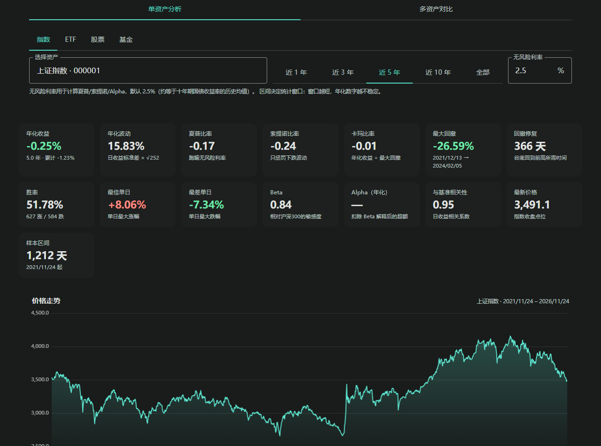
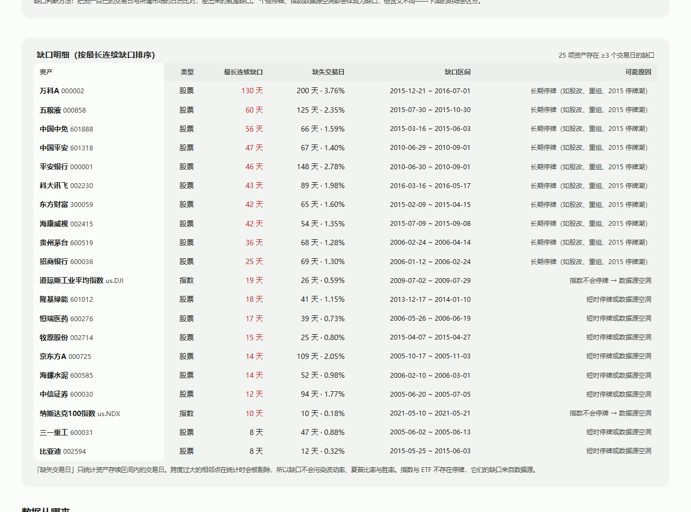
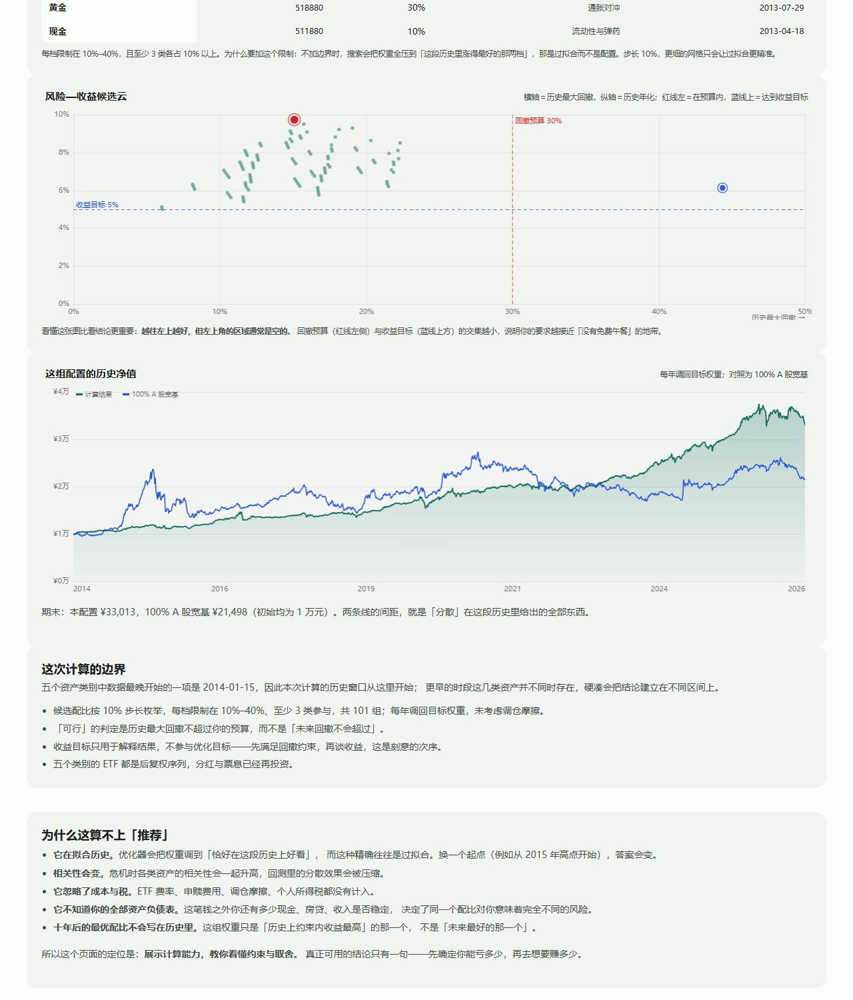
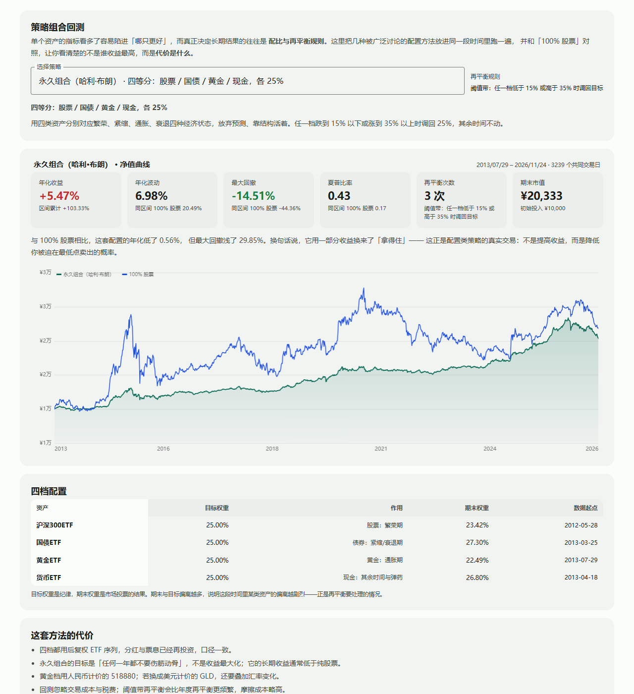
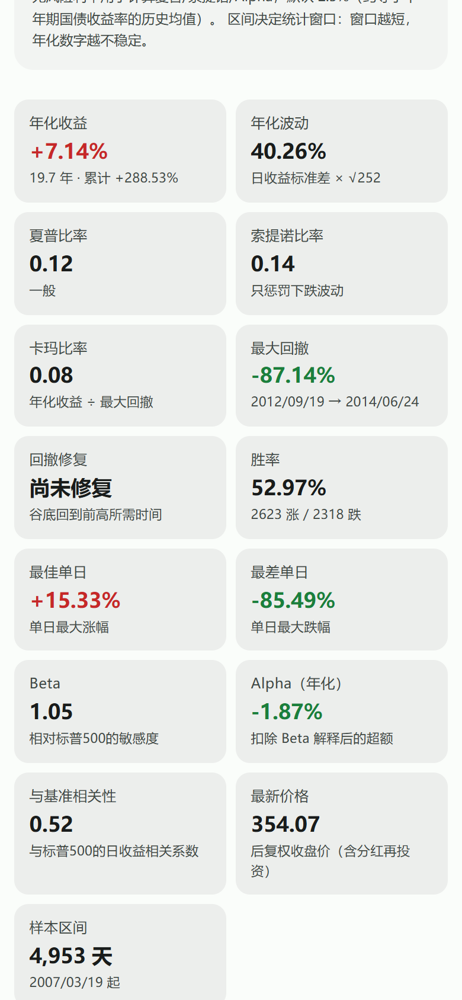

# 投资实验室 · Investment Lab

> 用二十年真实行情，把投资里那些「听起来懂了」的概念，变成你亲手算过一遍的数字。

在线站点：**https://angelky7.github.io/investment-lab/**

这是一个完全开源、零构建、零广告的投资学习实验室。它不荐股、不给目标价、不做预测，
只做三件事：**把收益讲清楚、把风险摆出来、把历史摊开看**。

- 界面基于 [MDUI 2](https://www.mdui.org)（Material You / Web Components），明暗双主题、移动端适配；
- 计算全部在浏览器里完成，公式开源，任何一个数字都能用 Excel 或 Python 复算；
- 数据每天由 GitHub Actions 自动更新并部署。


<sub>首页：四项资产的最新真实数字，以及七个入口。</sub>

| 资产分析（深色主题） | 历史时期复盘 |
|---|---|
|  |  |

| 组合压力测试 | 数据完整性（缺口逐条公开） |
|---|---|
|  |  |



<sub>配置求解器：每个点是一组合格配比，红线左侧在回撤预算内、蓝线上方达到收益目标。左上角的空白才是重点。</sub>



<sub>策略组合回测：四档配置、阈值带再平衡，并与「100% 股票」同区间对照。</sub>

<p>
  
  
</p>

<sub>竖屏（390×844）：指标卡两列、图表自适应、表单控件独占一行；
美股个股的 Beta 与相关性按标普500 计算；已适配 320–430px 宽度与横屏手机。</sub>

---

## 目录

- [一张图看清结构](#一张图看清结构)
- [八大页面](#八大页面)
- [资产覆盖](#资产覆盖)
- [数据管线](#数据管线)
- [配置求解器：按约束算，而不是按等级给](#配置求解器按约束算而不是按等级给)
- [策略组合：哈利·布朗永久组合](#策略组合哈利布朗永久组合)
- [指标定义与口径](#指标定义与口径)
- [为什么用后复权](#为什么用后复权)
- [本地开发](#本地开发)
- [测试](#测试)
- [自动化与部署](#自动化与部署)
- [已知局限](#已知局限)
- [免责声明](#免责声明)
- [许可](#许可)

---

## 一张图看清结构

```
investment-lab/
├── index.html              首页：数据速览 + 七个入口
├── learn.html              36 节投资课（小白 / 进阶 / 高级）+ 三组测验 + 决策训练
├── analysis.html           资产分析：单资产全指标 + 多资产同窗口对比
├── portfolio.html          组合分析：相关性 / 定投 / 压力测试 / 再平衡
├── history.html            历史时期复盘：7 个真实市场窗口 + 最近 12 个月
├── calculator.html         计算器：复利 / 定投 / 回撤回本 / 再平衡
├── planner.html            配置求解器：四题问卷 → 候选配比回测筛选（不构成推荐）
├── data.html               数据状态：来源、新鲜度、逐项完整性
│
├── css/app.css             业务样式（全部基于 MDUI 设计令牌，无硬编码浅色值）
├── vendor/mdui/            MDUI 2.1.5（MIT，随仓库分发，不依赖 CDN）
│
├── js/core/                纯逻辑层（可在 Node 里单测）
│   ├── series.js           序列工具：收益、回撤、日期对齐、降采样、直方图
│   ├── stats.js            指标引擎：年化、波动、夏普、索提诺、卡玛、Beta/Alpha
│   ├── portfolio.js        组合引擎：相关性、定投（含 XIRR）、再平衡、阈值带、压力测试
│   ├── strategies.js       预设策略（永久组合 / 60-40 / 对照）
│   ├── planner.js          配置求解：答案→约束、候选枚举、筛选与解释
│   ├── calc.js             计算器数学
│   ├── format.js           数字/日期格式化（红涨绿跌）
│   ├── store.js            数据加载与缓存
│   ├── charts.js           Canvas 图表（含十字线、主题跟随、HiDPI）
│   ├── shell.js            全站外壳：导航抽屉、主题切换、页脚
│   └── icons.js            内联 SVG 图标（不加载图标字体）
├── js/ui/                  通用控件：资产选择器、指标卡、表格
├── js/pages/               每个页面的入口模块
│
├── config/                 权威配置（提交到仓库）
│   ├── assets.json         55 项资产的登记表（名称、分组、代码、起始年份）
│   └── periods.json        历史时期与压力情景定义
├── data/                   构建产物（由脚本生成，勿手改）
│   ├── assets.json         资产索引（前端首屏只加载这个）
│   ├── meta.json           数据版本、截止日期、统计
│   ├── periods.json        时期与情景
│   ├── quality.json        质量校验报告
│   └── history/            {type}_{symbol}.json，列式存储
├── data_sources/           数据源实现（腾讯 / 东方财富）
├── scripts/                fetch / build / validate / repair / check_links / summary
├── tests/                  Node 单元测试 + Python 管线测试
│   └── e2e/                无头浏览器端到端（逐页切换子页签）
└── .github/workflows/      ci / update-data / deploy
```

---

## 八大页面

| 页面 | 解决什么问题 | 你会动手做什么 |
|------|--------------|----------------|
| 首页 | 这套工具可信吗 | 看四项资产的最新真实数字 |
| 投资课程 | 概念到底在说什么 | 算出「跌 30% 要涨 42.86% 才回本」 |
| 资产分析 | 这项资产好不好 | 对比两个资产的波动与回撤，看 Beta/Alpha |
| 组合分析 | 分散为什么有效 | 亲手算相关性、跑定投与压力测试、回测永久组合 |
| 历史时期 | 极端时刻会发生什么 | 把资产放进 2008 / 2015 / 2020 等真实窗口 |
| 计算器 | 复利与再平衡怎么运作 | 改参数看曲线如何变化 |
| **配置求解器** | 我的约束下还剩什么配比 | 答四题，看 100+ 组候选配置的回测筛选 |
| 数据状态 | 数据本身可靠吗 | 检查覆盖范围与断档 |

---

## 资产覆盖

**74 项资产、28.2 万条日频记录**，覆盖 A 股 / 港股 / 美股三个市场、股票 / ETF / 指数 / 场外基金四种类型。

表内为全部 14 个指数（含本次新增的恒生指数与中证A500）：

| 指数 | 代码 | 起点 | 记录数 | 备注 |
|------|------|------|--------|------|
| 沪深300 | 000300 | 2005-01 | 5316 | 全站默认基准 |
| 中证500 | 000905 | 2006-11 | 4865 | |
| 中证1000 | 000852 | 2013-11 | 3165 | |
| **中证A500** | 000510 | **2024-09-23** | 525 | 只采用正式发布后的数据，不含回溯模拟 |
| 上证指数 | 000001 | 2004-11 | 5353 | |
| 深证成指 | 399001 | 2004-11 | 5353 | |
| 创业板指 | 399006 | 2010-06 | 4001 | |
| 创业板50 | 399673 | 2014-06 | 3024 | |
| 上证50 | 000016 | 2004-11 | 5353 | |
| 科创50 | 000688 | 2020-01 | 1670 | |
| **标普500** | us.INX | **2005-01** | 5509 | 与美股交易日历完全对齐 |
| **纳斯达克100** | us.NDX | **2005-01** | 5499 | 2021-05 有 10 天源端空洞 |
| 道琼斯工业平均 | us.DJI | 2009-05 | 4389 | 源端最早只到 2009-05 |
| **恒生指数** | hkHSI | **2004-11** | 5422 | 港股日历（佛诞、圣诞等休市） |
| **上证国债指数** | 000012 | **2003-02** | 5771 | 给「债券」这一档提供足够长的历史 |
| **黄金ETF-SPDR（GLD）** | us.GLD.AM | **2004-11** | 5538 | 美元计价黄金，比 518880 早 9 年 |
| **美元兑人民币（在岸）** | USDCNY | **1994-08** | 8063 | 新浪外汇日 K，含 2005 汇改跳变 |

红利低波系列（512890 红利低波ETF / 515100 红利低波100ETF）采用**ETF 序列**：
中证红利低波动（H30269）与红利低波动100（930955）的指数点位接口对公开行情不可用，
而 ETF 是普通人真正能买到的载体，分红也已计入后复权。

其余 57 项：

- **A 股个股 24 项**：金融、消费、科技、制造、医药、地产、公用事业（含长江电力）
- **美股个股 7 项**：苹果、微软、英伟达、谷歌A、亚马逊、Meta Platforms、特斯拉（纳斯达克 `us.{TICKER}.OQ`）
- **ETF 20 项**：宽基 7、行业 4、跨境 4、大类资产 3、策略 2（红利低波 / 红利低波100）
- **汇率 1 项**：美元兑人民币（在岸），1994 年起
- **场外基金 7 项**：权益 3、债券 4（含中短债与 7-10 年国开债指数）

**Beta 与 Alpha 用哪个基准？** 按资产所属市场选：A 股→沪深300、港股→恒生指数、
美股→标普500。用 A 股基准去算美股个股的 Beta 没有解释力（交易日历和驱动因素都不同）。

**数据完整性怎么保证**

- 每个资产都与**所属市场自己的交易日历**比对（A 股用沪深300、港股用恒生、美股用标普500），
  该市场的假期不算缺失，所以「美股比 A 股少几天」不会被误报；
- 缺口会区分成因：指数与 ETF 不可能停牌，它们的缺口一定来自数据源；
  个股的长期缺口多为股权分置改革、2015 年停牌潮这类真实停牌；
- 缺失情况全部公开在[数据状态](https://angelky7.github.io/investment-lab/data.html)页，
  并在 `data/quality.json` 里留档；
- `scripts/repair.py` 可以针对缺口重新请求一次精确区间，只合并数据源真实返回的行。

---

## 配置求解器：按约束算，而不是按等级给

`planner.html` 是新加的栏目。回答四个问题后，它会：

1. 把五个资产类别（A 股宽基 / 海外股票 / 国债 / 黄金 / 现金）的**真实历史序列对齐**；
2. **枚举候选配比**（10% 步长、每档 10%–40%、至少 3 类参与）；
3. 对每一组跑一次年度再平衡的**完整回测**，算出年化、波动、最大回撤、夏普；
4. 先按「你的回撤预算」筛出可行集，再在可行集里取收益最高的那组。

### 与「风险等级 → 配比」对照表的区别

| | 常见做法 | 这里的做法 |
|---|---|---|
| 配比来源 | 人工映射（进取型 = 70% 股票） | 真实历史逐组回测后筛选 |
| 约束从哪来 | 单一「风险分」 | 回撤预算 × 投资期限 × 下跌应对方式 |
| 做不到时 | 仍然给一个方案 | 明确说「历史数据下达不到」，并给出最接近的那个 |
| 定位 | 推荐 | **计算演示**，页面上有一整段解释为什么它不是建议 |

### 三个刻意的设计取舍

- **约束优先于收益**：先用回撤预算筛掉「拿不住」的组合，再谈收益。因为拿不住的理论收益与你无关。
- **行为优先于数学**：如果回答「浮亏 20% 会全部卖出」，权益上限直接压到 20%。
  这一题比前三题都重要——它决定了数学模型里的收益在你的真实行为下能不能兑现。
- **必须加分散边界**：这是被真实数据逼出来的。不加边界时，搜索会把权重全压到
  「这段历史里涨得最好的两档」（实测给出过 60% 海外股票 + 40% 黄金、其余为 0），
  那是对窗口的过拟合而不是配置。所以每档限定 10%–40%、至少 3 类参与。

### 页面会告诉你什么

- 这组配比的历史年化 / 回撤 / 波动 / 夏普，以及**各档权重与数据起点**；
- 一张「风险—收益候选云」：每个点是一组合格配比，红线左侧是预算内、蓝线上方是达到收益目标——
  **左上角的空白区域才是重点**；
- 回撤预算是紧（可行组合很少）还是松（大部分都满足），以及到底是什么在塑造答案；
- 如果历史数据里没有能满足你要求的配置，它会直接说没有，而不是凑一个数字。

---

## 策略组合：哈利·布朗永久组合

「资产分析」回答的是「这项资产好不好」；但长期结果更多由**配比与再平衡规则**决定。
组合分析页新增「策略组合」标签页，把几种被广泛讨论的配置方法放进同一段时间里回测，
并与「100% 股票」对照。

### 永久组合在做什么

哈利·布朗（Harry Browne, 1987）的出发点不是预测哪类资产会涨，而是承认
**「我不知道未来是繁荣、通胀、紧缩还是衰退」**，于是四等分覆盖四种经济状态：

| 档位 | 本站采用 | 权重 | 对应经济状态 |
|------|----------|------|--------------|
| 股票 | 沪深300ETF（510300） | 25% | 繁荣 |
| 长期国债 | 国债ETF（511010） | 25% | 紧缩 / 衰退 |
| 黄金 | 黄金ETF（518880） | 25% | 通胀 |
| 现金 | 货币ETF（511880） | 25% | 其余时间，以及再平衡的弹药 |

**再平衡规则用布朗的原版：阈值带**——任一档跌破 15% 或涨过 35% 就调回 25%，
而不是「每年调一次」。这个细节很重要：它让组合在极端行情里自动「卖强买弱」，
但也意味着调仓次数不确定、摩擦成本略高于年度再平衡。

### 本站的回测结果（2013-07 ~ 2026-11，3239 个共同交易日）

| 组合 | 年化 | 年化波动 | 最大回撤 | 夏普 |
|------|------|----------|----------|------|
| 永久组合（4×25%，阈值带） | +5.47% | 6.98% | **−14.51%** | 0.43 |
| 60/40（每年再平衡） | +4.64% | 12.12% | −26.57% | 0.18 |
| 100% 股票（沪深300ETF） | +6.03% | 20.49% | −44.36% | 0.17 |

（100% 股票那一行是**与永久组合同一窗口**的对照，所以与「100% 股票」预设页签的 4.48% 不同——
那个预设用的是它自己的完整区间。）

读法：永久组合的年化比满仓股票低约 0.6 个百分点，但最大回撤浅了约 30 个百分点。
这是配置类策略的真实交易——**它不提高收益，它降低你被迫在最低点卖出的概率**。

### 三档预设

| 预设 | 配比 | 再平衡 |
|------|------|--------|
| 永久组合（哈利·布朗） | 4×25% | 阈值带 15% / 35% |
| 60/40 经典股债 | 股票 60% / 国债 40% | 每年 |
| 对照组：100% 股票 | 沪深300ETF 满仓 | 不调仓 |

所有档位都用**可投资的 ETF 与后复权序列**（含分红/票息再投资），
不用指数点位——混用会把股票档的收益算低约每年 2 个百分点。

---

## 数据管线

```
config/assets.json
        │
        ▼
scripts/fetch.py ──► data/history/*.json      （腾讯 / 东方财富，双源兜底）
        │
        ▼
scripts/build.py ──► data/assets.json / meta.json / periods.json
        │
        ▼
scripts/validate.py ─► data/quality.json      （完整性校验，错误会阻塞 CI）
```

**两种抓取模式**

- `incremental`（每日）：每个资产只回看最近 240 天，与已有序列合并去重。请求数 = 资产数，约 1–2 分钟。
- `full`（手动）：按 2 年窗口分片重建 2005 年以来的全部历史，用于首次建库或修复。

**为什么必须分片**：腾讯 K 线接口的区间请求返回的是「结束日之前最后 N 行」，
而不是区间全部行；单次 `count` 上限约 2000 行且不稳定。所以按 2 年、`count=520` 分片，
每片都恰好覆盖目标窗口。这一约束写在 `data_sources/tencent.py` 的注释里，改动前务必实测。

**双源兜底**：腾讯失败自动换东方财富（`push2his` → 统一换算成后复权口径）。
单资产失败不会中断整体流程，也不会丢失旧数据；缺失会体现在 `data/quality.json` 与「数据状态」页。

**空洞修复**：`scripts/repair.py` 按市场日历找出缺口，对每段缺口重新请求一次精确区间，
只合并数据源真实返回的行（不插值、不推断）。补不上的说明源端确实没有，由 validate 记录。

**统计口径**：相邻两个数据点相隔超过 10 个自然日时，这一段收益不计入波动率、夏普、
索提诺与胜率，避免把「停牌两个月」算成「一天跌 30%」。

---

## 指标定义与口径

| 指标 | 公式 | 读法 |
|------|------|------|
| 年化收益率 | `(期末/期初)^(1/年数) − 1`，年数按**自然日** | 长期平均速度，不代表过程平滑 |
| 年化波动率 | `std(日收益) × √252` | 过程的颠簸程度，不区分涨跌 |
| 夏普比率 | `(年化收益 − 无风险利率) / 年化波动` | 每单位波动换来多少超额收益 |
| 索提诺比率 | `(年化收益 − 无风险利率) / 下行波动` | 只惩罚下跌的版本 |
| 卡玛比率 | `年化收益 / |最大回撤|` | 为了收益，最坏要忍多深 |
| 最大回撤 | 从历史高点到之后最低点的跌幅 | 账户上真实出现过的最大浮亏 |
| 回撤修复 | 谷底回到前高所需交易日 | 未修复则显示「尚未修复」 |
| Beta | `cov(资产, 基准) / var(基准)` | 跟随大盘晃动的程度 |
| Alpha | `年化收益 − [Rf + β×(基准年化 − Rf)]` | 扣掉联动后的超额部分 |
| XIRR | 现金流 NPV = 0 的内部收益率 | 分期投入的正确年化口径 |

**几个刻意的取舍**

- 年化用自然日而不是「条数/252」：停牌、长假、不同交易日历会把后者系统性带偏。
- 数据不足时返回 `null` 而不是 `0`，页面显示「—」。把「没有数据」显示成「零收益」是误导。
- 相关性必须**按日期取交集**后再算，不能按「最短序列尾部切片」——后者在起始日期不同时会错位。
- 定投按「每月首个交易日」买入，而不是每 21 行买入；同时给出 XIRR。

---

## 为什么用后复权

行情接口的**前复权**数据对高分红股票会出现**负数历史价**
（实测贵州茅台 2013–2015 年前复权收盘价为 −187 元），根本没法算收益率。

因此本项目统一使用**后复权**（含分红再投资）：

- 收益率序列是正确的；
- 数值恒为正；
- 展示价格由前端按 `最新真实收盘价 ÷ 后复权末值` 缩放，等价于标准前复权，
  所以你在「价格走势」里看到的仍是熟悉的价位（例如茅台 1400 多元）。

基金使用东方财富的**累计净值**（优先），逻辑与后复权一致。

---

## 本地开发

无需构建、无需安装依赖，站点就是一组静态文件。

```bash
# 1. 起一个静态服务器（ES module 不能用 file:// 直接打开）
python -m http.server 8080
# 或者
npm run serve

# 2. 打开 http://127.0.0.1:8080/
```

需要 Node（测试用）与 Python 3.11+（数据抓取用）。运行时代码**没有任何第三方依赖**。

### 常用命令

```bash
npm test                 # 前端计算引擎单元测试（46 项）
npm run test:py          # 数据管线单元测试（21 项）
npm run test:all         # 全部

npm run data:fetch:incremental   # 增量抓取
npm run data:fetch               # 全量重建历史
npm run data:build               # 重新生成 data/ 索引
npm run data:validate            # 质量校验（错误非零退出）
npm run data:repair              # 修补历史空洞（只合并源端真实数据）
python scripts/check_links.py    # 静态引用与 ES 模块导入检查
```

---

## 测试

| 套件 | 命令 | 覆盖内容 |
|------|------|----------|
| 前端 | `node --test` | 序列对齐、指标公式、组合引擎、XIRR、阈值带再平衡、配置求解、格式化 |
| 数据管线 | `python -m unittest discover -s tests -p "test_*.py"` | K 线/净值解析、去重排序、校验规则、登记表一致性 |
| 静态检查 | `python scripts/check_links.py` | 页面引用是否存在、ES 模块导入名是否存在 |
| 端到端 | `npm run test:e2e` | 无头 Chrome 逐页加载、切换所有子页签、截图，要求零控制台报错 |

端到端脚本需要本机有 Chrome（`npx playwright install chromium` 亦可），
它复用系统浏览器，不额外下载几百 MB。测试重点放在「会悄悄算错」的地方：
日期对齐、分红口径、年化折算、分期投入的年化口径。

---

## 自动化与部署

| 工作流 | 触发 | 做什么 |
|--------|------|--------|
| `ci.yml` | push / PR | ESM 语法检查、Node 测试、Python 测试、数据完整性、静态引用检查 |
| `update-data.yml` | 每日 UTC 0:00 + 手动（可选 full） | 增量抓取 → 构建 → 校验 → 提交 → 触发部署 |
| `deploy.yml` | push main / Update Data 完成 | 上传 artifact → 部署 GitHub Pages |

数据源共三个：**腾讯行情**（股票 / ETF / 指数，后复权日 K）、
**东方财富**（基金累计净值，兼作行情兜底）、
**新浪财经**（外汇日 K，美元兑人民币自 1994 年起）。

抓取失败时保留旧数据继续部署，站点不会因为一次接口抖动而空掉。

---

## 已知局限

- **数据源空洞**：腾讯的纳斯达克100 在 2021-05 缺 10 个交易日、道琼斯在 2009-07 缺 19 个交易日；
  道指历史最早只到 2009-05。这些无法从源端补齐，已在「数据状态」页逐条列出；
- 后复权的分红再投资是按复权因子近似的，非逐笔股息到账；
- 基金累计净值不等于可再投资净值；
- ETF 折溢价、交易成本、税费、申赎限制、流动性冲击全部忽略；
- 跨市场对比取交易日交集，会损失各自的部分交易日；
- 交易日历以各资产自身数据为准；
- 压力测试假设「历史情景可重放」，不包含制度性变化。

这些近似对「理解风险结构」几乎无影响，但对精确到小数点后两位的业绩归因不够用。

---

## 免责声明

本站用于投资知识学习、历史数据分析与模拟研究，**不构成投资、税务或法律建议**。
历史收益不代表未来收益，回测结果不代表未来实际表现。

## 许可

代码与内容以 [MIT](LICENSE) 许可发布。行情数据版权归各数据源（腾讯、东方财富）所有，本站仅做学习用途的展示与分析。