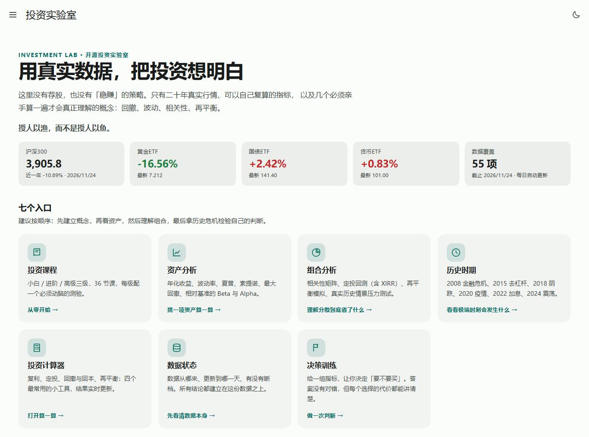
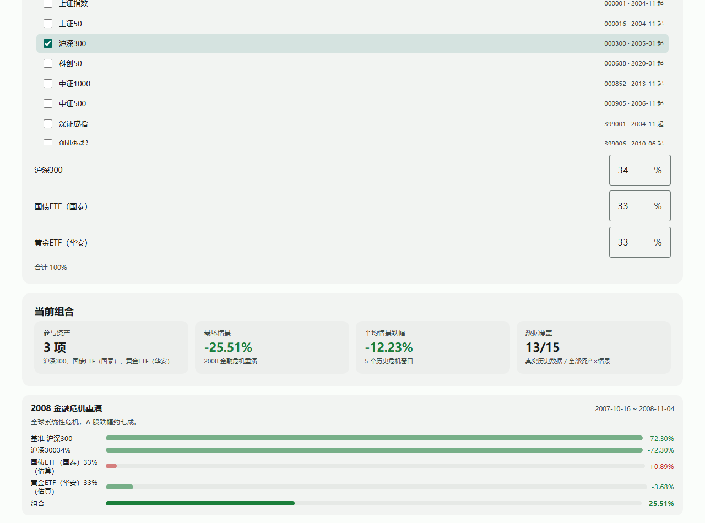

# 投资实验室 · Investment Lab

> 用二十年真实行情，把投资里那些「听起来懂了」的概念，变成你亲手算过一遍的数字。

在线站点：**https://angelky7.github.io/investment-lab/**

这是一个完全开源、零构建、零广告的投资学习实验室。它不荐股、不给目标价、不做预测，
只做三件事：**把收益讲清楚、把风险摆出来、把历史摊开看**。

- 界面基于 [MDUI 2](https://www.mdui.org)（Material You / Web Components），明暗双主题、移动端适配；
- 计算全部在浏览器里完成，公式开源，任何一个数字都能用 Excel 或 Python 复算；
- 数据每天由 GitHub Actions 自动更新并部署。



<sub>首页：四项资产的最新真实数字，以及七个入口。</sub>

| 资产分析（深色主题） | 历史时期复盘 |
|---|---|
|  |  |



<sub>压力测试用真实历史区间的资产跌幅回答「如果那段行情重演，我现在这个组合会怎样」。</sub>

---

## 目录

- [一张图看清结构](#一张图看清结构)
- [七大页面](#七大页面)
- [数据管线](#数据管线)
- [指标定义与口径](#指标定义与口径)
- [为什么用后复权](#为什么用后复权)
- [本地开发](#本地开发)
- [测试](#测试)
- [自动化与部署](#自动化与部署)
- [已知局限](#已知局限)
- [免责声明](#免责声明)
- [许可](#许可)

---

## 一张图看清结构

```
investment-lab/
├── index.html              首页：数据速览 + 七个入口
├── learn.html              36 节投资课（小白 / 进阶 / 高级）+ 三组测验 + 决策训练
├── analysis.html           资产分析：单资产全指标 + 多资产同窗口对比
├── portfolio.html          组合分析：相关性 / 定投 / 压力测试 / 再平衡
├── history.html            历史时期复盘：7 个真实市场窗口 + 最近 12 个月
├── calculator.html         计算器：复利 / 定投 / 回撤回本 / 再平衡
├── data.html               数据状态：来源、新鲜度、逐项完整性
│
├── css/app.css             业务样式（全部基于 MDUI 设计令牌，无硬编码浅色值）
├── vendor/mdui/            MDUI 2.1.5（MIT，随仓库分发，不依赖 CDN）
│
├── js/core/                纯逻辑层（可在 Node 里单测）
│   ├── series.js           序列工具：收益、回撤、日期对齐、降采样、直方图
│   ├── stats.js            指标引擎：年化、波动、夏普、索提诺、卡玛、Beta/Alpha
│   ├── portfolio.js        组合引擎：相关性、定投（含 XIRR）、再平衡、压力测试
│   ├── calc.js             计算器数学
│   ├── format.js           数字/日期格式化（红涨绿跌）
│   ├── store.js            数据加载与缓存
│   ├── charts.js           Canvas 图表（含十字线、主题跟随、HiDPI）
│   ├── shell.js            全站外壳：导航抽屉、主题切换、页脚
│   └── icons.js            内联 SVG 图标（不加载图标字体）
├── js/ui/                  通用控件：资产选择器、指标卡、表格
├── js/pages/               每个页面的入口模块
│
├── config/                 权威配置（提交到仓库）
│   ├── assets.json         55 项资产的登记表（名称、分组、代码、起始年份）
│   └── periods.json        历史时期与压力情景定义
├── data/                   构建产物（由脚本生成，勿手改）
│   ├── assets.json         资产索引（前端首屏只加载这个）
│   ├── meta.json           数据版本、截止日期、统计
│   ├── periods.json        时期与情景
│   ├── quality.json        质量校验报告
│   └── history/            {type}_{symbol}.json，列式存储
├── data_sources/           数据源实现（腾讯 / 东方财富）
├── scripts/                fetch / build / validate / check_links
├── tests/                  Node 单元测试 + Python 管线测试
└── .github/workflows/      ci / update-data / deploy
```

---

## 七大页面

| 页面 | 解决什么问题 | 你会动手做什么 |
|------|--------------|----------------|
| 首页 | 这套工具可信吗 | 看四项资产的最新真实数字 |
| 投资课程 | 概念到底在说什么 | 算出「跌 30% 要涨 42.86% 才回本」 |
| 资产分析 | 这项资产好不好 | 对比两个资产的波动与回撤，看 Beta/Alpha |
| 组合分析 | 分散为什么有效 | 亲手算相关性，跑一次定投和压力测试 |
| 历史时期 | 极端时刻会发生什么 | 把资产放进 2008 / 2015 / 2020 等真实窗口 |
| 计算器 | 复利与再平衡怎么运作 | 改参数看曲线如何变化 |
| 数据状态 | 数据本身可靠吗 | 检查覆盖范围与断档 |

---

## 数据管线

```
config/assets.json
        │
        ▼
scripts/fetch.py ──► data/history/*.json      （腾讯 / 东方财富，双源兜底）
        │
        ▼
scripts/build.py ──► data/assets.json / meta.json / periods.json
        │
        ▼
scripts/validate.py ─► data/quality.json      （完整性校验，错误会阻塞 CI）
```

**两种抓取模式**

- `incremental`（每日）：每个资产只回看最近 240 天，与已有序列合并去重。请求数 = 资产数，约 1–2 分钟。
- `full`（手动）：按 2 年窗口分片重建 2005 年以来的全部历史，用于首次建库或修复。

**为什么必须分片**：腾讯 K 线接口的区间请求返回的是「结束日之前最后 N 行」，
而不是区间全部行；单次 `count` 上限约 2000 行且不稳定。所以按 2 年、`count=520` 分片，
每片都恰好覆盖目标窗口。这一约束写在 `data_sources/tencent.py` 的注释里，改动前务必实测。

**双源兜底**：腾讯失败自动换东方财富（`push2his` 前复权 → 统一换算成后复权口径）。
单资产失败不会中断整体流程，也不会丢失旧数据；缺失会体现在 `data/quality.json` 与「数据状态」页。

---

## 指标定义与口径

| 指标 | 公式 | 读法 |
|------|------|------|
| 年化收益率 | `(期末/期初)^(1/年数) − 1`，年数按**自然日** | 长期平均速度，不代表过程平滑 |
| 年化波动率 | `std(日收益) × √252` | 过程的颠簸程度，不区分涨跌 |
| 夏普比率 | `(年化收益 − 无风险利率) / 年化波动` | 每单位波动换来多少超额收益 |
| 索提诺比率 | `(年化收益 − 无风险利率) / 下行波动` | 只惩罚下跌的版本 |
| 卡玛比率 | `年化收益 / |最大回撤|` | 为了收益，最坏要忍多深 |
| 最大回撤 | 从历史高点到之后最低点的跌幅 | 账户上真实出现过的最大浮亏 |
| 回撤修复 | 谷底回到前高所需交易日 | 未修复则显示「尚未修复」 |
| Beta | `cov(资产, 基准) / var(基准)` | 跟随大盘晃动的程度 |
| Alpha | `年化收益 − [Rf + β×(基准年化 − Rf)]` | 扣掉联动后的超额部分 |
| XIRR | 现金流 NPV = 0 的内部收益率 | 分期投入的正确年化口径 |

**几个刻意的取舍**

- 年化用自然日而不是「条数/252」：停牌、长假、不同交易日历会把后者系统性带偏。
- 数据不足时返回 `null` 而不是 `0`，页面显示「—」。把「没有数据」显示成「零收益」是误导。
- 相关性必须**按日期取交集**后再算，不能按「最短序列尾部切片」——后者在起始日期不同时会错位。
- 定投按「每月首个交易日」买入，而不是每 21 行买入；同时给出 XIRR。

---

## 为什么用后复权

行情接口的**前复权**数据对高分红股票会出现**负数历史价**
（实测贵州茅台 2013–2015 年前复权收盘价为 −187 元），根本没法算收益率。

因此本项目统一使用**后复权**（含分红再投资）：

- 收益率序列是正确的；
- 数值恒为正；
- 展示价格由前端按 `最新真实收盘价 ÷ 后复权末值` 缩放，等价于标准前复权，
  所以你在「价格走势」里看到的仍是熟悉的价位（例如茅台 1400 多元）。

基金使用东方财富的**累计净值**（优先），逻辑与后复权一致。

---

## 本地开发

无需构建、无需安装依赖，站点就是一组静态文件。

```bash
# 1. 起一个静态服务器（ES module 不能用 file:// 直接打开）
python -m http.server 8080
# 或者
npm run serve

# 2. 打开 http://127.0.0.1:8080/
```

需要 Node（测试用）与 Python 3.11+（数据抓取用）。运行时代码**没有任何第三方依赖**。

### 常用命令

```bash
npm test                 # 前端计算引擎单元测试（46 项）
npm run test:py          # 数据管线单元测试（21 项）
npm run test:all         # 全部

npm run data:fetch:incremental   # 增量抓取
npm run data:fetch               # 全量重建历史
npm run data:build               # 重新生成 data/ 索引
npm run data:validate            # 质量校验（错误非零退出）
python scripts/check_links.py    # 静态引用与 ES 模块导入检查
```

---

## 测试

| 套件 | 命令 | 覆盖内容 |
|------|------|----------|
| 前端 | `node --test` | 序列对齐、指标公式、组合引擎、XIRR、压力测试、格式化 |
| 数据管线 | `python -m unittest discover -s tests -p "test_*.py"` | K 线/净值解析、去重排序、校验规则、登记表一致性 |
| 静态检查 | `python scripts/check_links.py` | 页面引用是否存在、ES 模块导入名是否存在 |
| 端到端 | `npm run test:e2e` | 无头 Chrome 逐页加载、切换所有子页签、截图，要求零控制台报错 |

端到端脚本需要本机有 Chrome（`npx playwright install chromium` 亦可），
它复用系统浏览器，不额外下载几百 MB。测试重点放在「会悄悄算错」的地方：
日期对齐、分红口径、年化折算、分期投入的年化口径。

---

## 自动化与部署

| 工作流 | 触发 | 做什么 |
|--------|------|--------|
| `ci.yml` | push / PR | ESM 语法检查、Node 测试、Python 测试、数据完整性、静态引用检查 |
| `update-data.yml` | 每日 UTC 0:00 + 手动（可选 full） | 增量抓取 → 构建 → 校验 → 提交 → 触发部署 |
| `deploy.yml` | push main / Update Data 完成 | 上传 artifact → 部署 GitHub Pages |

抓取失败时保留旧数据继续部署，站点不会因为一次接口抖动而空掉。

---

## 已知局限

- 后复权的分红再投资是按复权因子近似的，非逐笔股息到账；
- 基金累计净值不等于可再投资净值；
- ETF 折溢价、交易成本、税费、申赎限制、流动性冲击全部忽略；
- 跨市场对比取交易日交集，会损失各自的部分交易日；
- 交易日历以各资产自身数据为准；
- 压力测试假设「历史情景可重放」，不包含制度性变化。

这些近似对「理解风险结构」几乎无影响，但对精确到小数点后两位的业绩归因不够用。

---

## 免责声明

本站用于投资知识学习、历史数据分析与模拟研究，**不构成投资、税务或法律建议**。
历史收益不代表未来收益，回测结果不代表未来实际表现。

## 许可

代码与内容以 [MIT](LICENSE) 许可发布。行情数据版权归各数据源（腾讯、东方财富）所有，本站仅做学习用途的展示与分析。